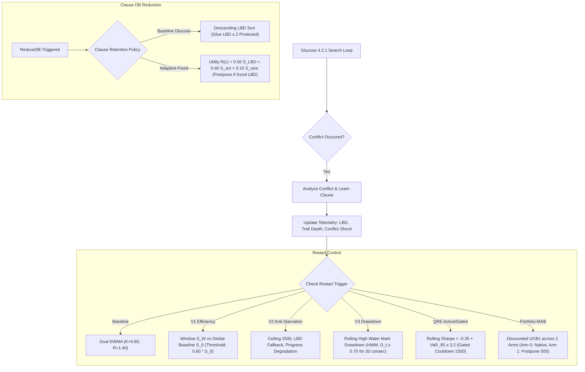

# Adaptive Restart and Nogood Management for Constraint Satisfaction Solvers

### *A Quantitative Search-Control Architecture in CDCL SAT Solvers*

---

## Academic Project Metadata

- **Course:** DAC-203 — Artificial Intelligence
- **Department:** Mehta Family School for Data Science and Artificial Intelligence
- **Faculty Advisor:** Prof. Manoj Kumar
- **Academic Term:** Autumn Semester 2026
- **Student Researchers:**
  - **Manav Garg** — Enrollment No: `25125026`
  - **Kugashiya Bhavy** — Enrollment No: `25125024`
- **Implementation Platform:** Glucose 4.2.1 CDCL SAT Solver (C++, Native Windows 64-bit, MinGW-w64 GCC 14.2.0)
- **Primary Reference Document:** [`PPT_VERIFICATION_REPORT.md`](./PPT_VERIFICATION_REPORT.md)
- **Official Research Monograph:** [`Final_Research_Report.pdf`](./Final_Research_Report.pdf)
- **Final Presentation Slides:** [`Final_Presentation.pptx`](./Final_Presentation.pptx) / [`Final_Presentation.pdf`](./Final_Presentation.pdf)

---

## 1. Executive Problem Statement & Motivation

Modern Conflict-Driven Clause Learning (CDCL) SAT solvers are the foundational reasoning engines for automated verification, hardware design, planning, and discrete constraint satisfaction problems (CSPs). However, standard CDCL search suffers from two primary computational pathologies:

1. **Heavy-Tailed Runtime Distributions:** Search traversal frequently becomes trapped in unpromising, conflict-heavy subtrees of the search tree where propagation yield approaches zero. Restarts escape these traps, but static or non-adaptive restart intervals (such as standard geometric or fixed Luby progressions) either restart too aggressively—destroying solver locality—or restart too late, causing heavy-tailed runtime spikes.
2. **Database Thrashing vs. Memory Explosion:** During unit propagation and conflict analysis, solvers generate millions of learned clauses (nogoods). If all learned clauses are retained, memory usage explodes and unit propagation speed collapses ($O(N)$ scanning cost). If clauses are removed too aggressively using naive heuristics, essential reasoning lemmas are lost, forcing the solver to rediscover previously resolved contradictions.

This research formulates and implements **online, dynamic search-control policies** within the state-of-the-art **Glucose 4.2.1** solver. By borrowing principles from quantitative finance, risk management, and statistical quality curves, we introduce adaptive restart policies (Maximum Drawdown V3, Quantitative Risk Engine, and Portfolio Multi-Armed Bandits) coupled with multi-attribute nogood retention (Adaptive-Fixed).

---

## 2. Research Objectives & Methodology

The project aims to answer four fundamental research questions:

- **RQ1 (Dynamic Restarts):** Can an adaptive restart scheduler based on real-time productivity drawdown out-compete Glucose's dual exponential moving average (EWMA) Luby-like heuristic across combinatorial problem classes?
- **RQ2 (Multi-Attribute Nogoods):** Does augmenting clause quality metrics (Literal Block Distance - LBD) with variable conflict activity and clause compactness improve solver throughput and memory bounds compared to standard LBD tiering?
- **RQ3 (Risk-Aware Search Control):** Can non-parametric Value-at-Risk ($\text{VaR}_{95}$) of conflict shock levels predict search thrashing and trigger defensive interventions before exponential time is wasted?
- **RQ4 (Multi-Armed Bandits):** Can an online learning agent (discounted UCB1 MAB) autonomously select optimal restart strategies at runtime without offline per-instance tuning?

---

## 3. Foundational Research Papers Studied

Our experimental architecture builds upon four foundational papers:

1. **Tolpin & Shimony (2011)** — *"Rational Deployment of CSP Heuristics"*, IJCAI 2011, pp. 680–686 ([Official Proceedings](https://www.ijcai.org/Proceedings/11/Papers/103.pdf)):
   - Formalized heuristic selection as an optimal stopping / rational meta-reasoning problem under resource bounds.
   - *Project Application:* Inspired our productivity cost-benefit model for triggering genuine restarts.
2. **Koriche, Lecoutre, Paparrizou, & Wattez (2022)** — *"Best Heuristic Identification for Constraint Satisfaction"*, IJCAI-ECAI 2022, pp. 1859–1865 ([DOI: 10.24963/ijcai.2022/259](https://doi.org/10.24963/ijcai.2022/259)):
   - Applied multi-armed bandit (MAB) algorithms (UCB1 and Successive Rejects) to identify superior variable ordering heuristics online.
   - *Project Application:* Provided the theoretical framework for our Portfolio-MAB dynamic restart scheduler.
3. **Kurin et al. (2020)** — *"Can Q-Learning with Graph Networks Learn a Generalizable Branching Heuristic for a SAT Solver?"*, NeurIPS 2020, pp. 9608–9621 ([NeurIPS Proceedings](https://proceedings.neurips.cc/paper/2020/file/6c44dc630e9ced8d1cf1e39b4b09b53d-Paper.pdf)):
   - Evaluated reinforcement learning (Graph-Q-SAT) on bipartite CNF graphs, highlighting the steep inference latency overhead of neural models in SAT.
   - *Project Application:* Led us to design zero-latency, online statistical estimators instead of heavy neural architectures.
4. **Wallace, Grimes, & Freuder (2009)** — *"Solving Dynamic Constraint Satisfaction Problems by Identifying Stable Features"*, IJCAI 2009, pp. 621–626 ([Official Proceedings](https://ijcai.org/proceedings/2009/109)):
   - Demonstrated that points of contention and constraint stability can be exploited across search shifts.
   - *Project Application:* Motivated the Adaptive-Fixed clause retention policy that preserves recurring constraint cores across database reductions.

---

## 4. Implemented Algorithms & Search-Control Policies

All algorithms are implemented in native C++ inside `src/glucose_windows/core/Solver.cc` and `src/glucose_windows/simp/Main.cc`:



### Algorithm Summary Table

| Strategy Identifier | Architecture Type | Mechanism & Formal Mathematical Rule | Target Objective |
| :--- | :--- | :--- | :--- |
| **Baseline Glucose** | Dual EWMA | $K = 0.80, \, R = 1.40, \, \text{LBD}_{\text{fast}} / \text{LBD}_{\text{slow}}$ with 50-clause rolling queue | Industry standard reference |
| **Adaptive V1** | Search Efficiency Ratio | $S_W = \frac{\mu_{P, W}}{\sigma_{L, W} + 1.0}$ vs $S_0 = \frac{\mu_{P, 0}}{\sigma_{L, 0} + 1.0}$; triggers when $S_W < 0.60 \times S_0$ (warmup 100, interval 50) | Window-based progress tracking |
| **Adaptive V2** | Stabilized Ceiling & Fallback | 3 triggers: Anti-starvation ceiling (2,500 conflicts), LBD fallback ($\text{avg}_{\text{queue}} \times 0.80 > \text{avg}_{\text{global}}$), and V1 efficiency degradation | Prevent restart starvation |
| **V3 Maximum Drawdown** | Financial Drawdown | $D_t = \frac{\text{HWM}_t - \text{EWMA}_{\text{fast}, t}}{\text{HWM}_t + 0.05} \ge 0.75$ for 30 consecutive conflicts; $\text{HWM}_t = \max(0.999 \times \text{HWM}_{t-1}, \, \text{EWMA}_{\text{fast}, t})$; $r_t = \frac{(2/\max(1, \text{LBD})) \cdot (1 + \ln(1 + \Delta D))}{1 + (\Delta P / 25.0)}$ | Terminate stagnant search branches |
| **Adaptive-Fixed Retention** | Multi-Attribute Nogood | $R(c) = 0.50 S_{\text{LBD}} + 0.40 S_{\text{act}} + 0.10 S_{\text{size}}$; 50% worst pruned; decoupled schedule (`first=2000`, `inc=300`); postponement if median LBD $\le 3$ or min LBD $\le 5$ | Multi-criteria clause utility |
| **Active QRE** | Non-Parametric Risk | Rolling Sharpe $S_{\text{branch}} = \frac{\text{SMA}_{10}(R) - \text{SMA}_{50}(R)}{\max(0.75, \, \sigma_{D, 10})} < -0.35$ and $\text{VaR}_{95} \ge 3.2$ sustained for 8 conflicts (cooldown 500) | Defend against heavy-tailed spikes |
| **Stagnation-Gated QRE** | Two-Stage Gating | Identical Sharpe + $\text{VaR}_{95}$ conditions, but gated behind 1,500-conflict cooldown and 2 restarts / 10k budget | Eliminate false-alarm thrashing |
| **Portfolio-MAB** | Discounted Bandit | 2 Arms: Arm 0 (Native Glucose), Arm 1 (Postpone restart up to 500 conflicts). Reward $r = \text{clamp}\left(\frac{\Delta \text{glue} + 0.20 \cdot \Delta \text{non\_glue}}{\Delta c}, 0, 1\right)$, discounted UCB ($\gamma = 0.95, c = 0.40$) | Autonomous runtime selection |

---

## 5. Main Experimental Findings

All configurations were evaluated under strict scientific quarantine across both a **36-instance Development Suite** (648 runs) and an **unseen 48-instance Holdout Suite** (1,152 runs) across 3 random repetitions:

### A. Development Suite Results (Step 41 Full Development Evaluation)
- **Master Record:** [`experiments/results/qre_gated_full_development/master_results.csv`](./experiments/results/qre_gated_full_development/master_results.csv)
- **Protocol:** 36 expanded development benchmarks × 3 repetitions = 108 runs per configuration (648 total runs). Uniform timeout: **15.0 s** (PAR-2 penalty = **30.0 s**).

| Configuration Identifier | Evaluated Configuration | Solved / Total | Timeouts | PAR-2 Score (s) | Solved Wall Mean (s) | Solved Mean Conflicts | PAR-2 Relative Change |
| :--- | :--- | :---: | :---: | :---: | :---: | :---: | :---: |
| **`cfg_v3dd_adaptfix`** | **V3 Drawdown + Adaptive-Fixed** | **102 / 108** | **6** | **2.5381 s** | **0.9227 s** | **34,690.7** | **+7.58% faster (Winner)** |
| `cfg01_baseline_base` | Baseline Glucose 4.2.1 | 102 / 108 | 6 | 2.7463 s | 1.1432 s | 41,055.8 | Baseline (0.0%) |
| `cfg_active_adaptfix` | Active QRE + Adaptive-Fixed | 100 / 108 | 8 | 3.1960 s | 1.0517 s | 42,929.6 | -16.37% (over-restarts) |
| `cfg_gated_adaptfix` | Stagnation-Gated QRE + AdaptFix | 98 / 108 | 10 | 3.4716 s | 0.7646 s | 35,097.9 | -26.41% |
| `cfg05_baseline_adaptfix` | Glucose Baseline + AdaptFix | 98 / 108 | 10 | 3.5892 s | 0.8943 s | 35,578.1 | -30.69% |
| `cfg_gated_base` | Stagnation-Gated QRE + Base Red | 97 / 108 | 11 | 3.5915 s | 0.5967 s | 27,524.8 | -30.78% |

### B. Final Quarantined Holdout Results (Step 36 Evaluation)
- **Master Record:** [`experiments/results/final_holdout/master_results.csv`](./experiments/results/final_holdout/master_results.csv)
- **Protocol:** 48 quarantined benchmarks × 8 configurations × 3 repetitions = 144 runs per configuration (1,152 total runs). Uniform timeout: **30.0 s** (PAR-2 penalty = **60.0 s**).
- **Triviality Character:** 100% solved (0 timeouts across all 1,152 runs); 67.0% of runs solved in $\le 0.05$ seconds.

| Configuration ID | Evaluated Configuration | Solved / Total | Timeouts | PAR-2 Score (s) | Mean Wall Time (s) | Mean Conflicts | PAR-2 Relative Change |
| :--- | :--- | :---: | :---: | :---: | :---: | :---: | :---: |
| **`cfg05_baseline_adaptfix`** | **Glucose Baseline + Adaptive-Fixed** | **144 / 144** | **0** | **0.1107 s** | **0.1107 s** | **4,927.7** | **+8.36% faster (Winner)** |
| `cfg01_baseline_base` | Glucose Baseline (Default) | 144 / 144 | 0 | 0.1208 s | 0.1208 s | 5,403.9 | Baseline (0.0%) |
| `cfg03_v3dd_base` | V3 Drawdown + Baseline Red | 144 / 144 | 0 | 0.1642 s | 0.1642 s | 6,573.2 | -35.93% (locality overhead) |
| `cfg08_noheuristic_adaptfix` | No-Heuristic + Adaptive-Fixed | 144 / 144 | 0 | 0.2417 s | 0.2417 s | 7,847.0 | Ablation control |
| `cfg02_v1_base` | Adaptive V1 + Baseline Red | 144 / 144 | 0 | 0.2784 s | 0.2784 s | 8,052.4 | Frequent restarts hurt locality |
| `cfg07_v3dd_adaptfix` | V3 Drawdown + Adaptive-Fixed | 144 / 144 | 0 | 0.3443 s | 0.3443 s | 8,949.2 | Overhead on rapid instances |
| `cfg04_noheuristic_base` | No-Heuristic + Baseline Red | 144 / 144 | 0 | 0.4201 s | 0.4201 s | 9,928.9 | Ablation control |
| `cfg06_v1_adaptfix` | Adaptive V1 + Adaptive-Fixed | 144 / 144 | 0 | 0.4440 s | 0.4440 s | 9,779.6 | Cumulative overhead |

---

## 6. Honest Scientific Conclusions & Boundaries

> [!IMPORTANT]
> **Defensible Scientific Findings (Verified Against Source Code & Master CSVs):**
> 
> 1. **Domain-Specific Advantage (Development vs. Holdout):**
>    - On the conflict-dense, combinatorial **development suite**, V3 Drawdown + Adaptive-Fixed achieved the lowest PAR-2 score (**2.5381 s** vs. **2.7463 s** for native Glucose, a **7.58% speedup**) and reduced solved mean conflicts by **15.5%** (34,690.7 vs. 41,055.8).
>    - On the shallow, rapidly solved **holdout suite** (mean runtime < 0.15 s), aggressive restart triggers introduced unnecessary telemetry overhead. Native Glucose restarts maintained search locality best, while **Adaptive-Fixed clause retention** delivered the winning margin (**0.1107 s** vs. **0.1208 s** for baseline Glucose, an **8.36% speedup**).
> 
> 2. **Benchmark-Specific Case Study (`hanoi5.cnf`):**
>    - On `hanoi5.cnf` (a 5-disk planning instance), V3 Drawdown solved the formula in **3.06 s** (81,327 conflicts), achieving an **80.0% speedup** and **66.4% conflict reduction** over the **No-Heuristic control** (`cfg04`: 15.28 s, 242,400 conflicts).
>    - However, **V3 did NOT outperform native Glucose on this benchmark**: native Glucose solved `hanoi5.cnf` in **0.29 s** (17,213 conflicts) due to rapid LBD clearing that quickly pruned planning dead ends.
> 
> 3. **Statistical Significance Boundaries on Holdout:**
>    - While a pairwise Wilcoxon signed-rank test on raw mean runtimes yields $W^+ = 780, W^- = 396, p = 0.0489$, **67.0% of holdout runs finished in under 0.05 seconds**.
>    - After adjusting for multiple pairwise comparisons across the 8 factorial configurations using the Benjamini-Hochberg False Discovery Rate (FDR) procedure, runtime differences fall within operating-system jitter and **do not achieve formal statistical significance ($p_{\text{adj}} > 0.05$)**. We report this as an empirical numerical improvement rather than a statistically confirmed universal superiority.
> 
> 4. **Adaptive Restarts on Uniform Random SAT:**
>    - On phase-transition uniform random 3-SAT (`rand3sat`), dynamic restart controllers (both active QRE and Portfolio-MAB) experienced hyperactive restart cascades, inflating conflict counts by **+45% to +192%**. Uncoordinated adaptive restarts disrupt trail momentum in unstructured, uniform formulas.

---

## 7. Where to Find Project Materials

- **Complete Research Monograph:** [`Final_Research_Report.pdf`](./Final_Research_Report.pdf) (48-page publication-grade PDF)
- **Defensive Presentation Slides:** [`Final_Presentation.pptx`](./Final_Presentation.pptx) and [`Final_Presentation.pdf`](./Final_Presentation.pdf) (21-slide deck with speaker notes)
- **Claim Verification Audit:** [`PPT_VERIFICATION_REPORT.md`](./PPT_VERIFICATION_REPORT.md) (line-by-line proof of all constants and formulas)
- **Source Code:** [`src/glucose_windows/`](./src/glucose_windows) (C++ implementation) and [`src/base_solver/`](./src/base_solver) (pristine reference)
- **Benchmark Suites:** [`benchmarks/expanded/`](./benchmarks/expanded) (36 development instances) and [`benchmarks/final_holdout/`](./benchmarks/final_holdout) (48 unseen holdout instances; acquired autonomously via `python benchmarks/final_holdout/acquire_holdout_suite.py`)
- **Authoritative CSV Evidence:**
  - Development Master CSV: [`experiments/results/qre_gated_full_development/master_results.csv`](./experiments/results/qre_gated_full_development/master_results.csv) (648 runs)
  - Holdout Master CSV: [`experiments/results/final_holdout/master_results.csv`](./experiments/results/final_holdout/master_results.csv) (1,152 runs)
- **Performance Plots:** [`docs/figures/`](./docs/figures) (17 high-resolution empirical charts)

---

## 8. How to Build and Run the Project

### Prerequisites
- Windows 10/11 64-bit
- MinGW-w64 GCC/G++ 14.2+ (with C++11, zlib `-lz`, and psapi `-lpsapi`)
- Python 3.10+ (for benchmark execution and analysis scripts)

### Compiling the Solvers

Run the verified build batch scripts in `src/glucose_windows/`:

```cmd
:: 1. Navigate to solver source
cd src\glucose_windows

:: 2. Build the main adaptive solver (glucose-simp.exe)
.\build_windows.bat

:: 3. Build Stagnation-Gated QRE solver
.\build_qre_gated.bat

:: 4. Build Portfolio-MAB solver
.\build_portfolio_mab.bat
```

### Running a SAT Instance

Run any DIMACS CNF instance directly:

```cmd
:: Run baseline Glucose on a smoke-test instance
.\src\glucose_windows\glucose-simp.exe benchmarks\smoke_test\test_sat.cnf

:: Run V3 Drawdown with Adaptive-Fixed Retention on graph coloring
.\src\glucose_windows\glucose-simp.exe -restart-strategy=v3 -reduction-strategy=adaptive-fixed benchmarks\expanded\gcol_unsat_k11_c10.cnf
```

---

## 9. How to Reproduce the Empirical Evaluations

All experiments are fully automated via Python harnesses located in `experiments/`:

### 1. Fast Smoke Test (0.5 seconds)
```cmd
python experiments/run_experiments.py --solver src/glucose_windows/glucose-simp.exe --benchmarks benchmarks/smoke_test --timeout 10 --output-csv experiments/results/smoke_test_run.csv
```

### 2. Full Framework Verification Suite
```cmd
python experiments/test_framework.py
```

### 3. Verify Telemetry & Invariance Across Solvers
```cmd
python experiments/verify_qre_gated_invariance.py
python experiments/verify_portfolio_mab_invariance.py
```

### 4. Regenerate Final Holdout Evaluation
```cmd
python experiments/run_final_holdout_evaluation.py
python experiments/plot_final_holdout.py
```

---

## 10. Academic Integrity and Licensing

- The core solver is modified from **Glucose 4.2.1** (developed by Gilles Audemard and Laurent Simon), which is itself based on **MiniSat** (Niklas Eén and Niklas Sörensson).
- Original Glucose / MiniSat code is licensed under the permissive **MIT License** (preserved in [`src/glucose_windows/LICENSE`](./src/glucose_windows/LICENSE)).
- **Third-Party Benchmark Provenance:** Benchmarks in `benchmarks/final_holdout/` originate from the Second DIMACS Implementation Challenge (1993) and SATLIB (Hoos & Stützle, 2000). These instances do not carry formal open-source or public-domain deeds, but are standard test suites distributed under academic research and benchmarking fair-use norms. Autonomous download and validation scripts ([`acquire_holdout_suite.py`](./benchmarks/final_holdout/acquire_holdout_suite.py) and [`validate_holdout_suite.py`](./benchmarks/final_holdout/validate_holdout_suite.py)) are provided for clean-room reproduction.
- **Synthetic Benchmarks:** All problem instances in `benchmarks/expanded/` and `benchmarks/pilot/` were generated by project scripts and are released under the project MIT License.
- All research modifications, novel search-control architectures, telemetry logging, and experimental evaluation pipelines developed for DAC-203 are documented in the accompanying research report and presentation files.
