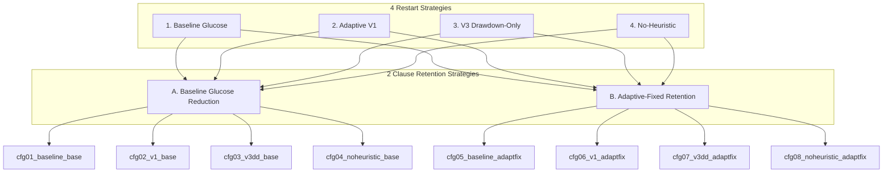
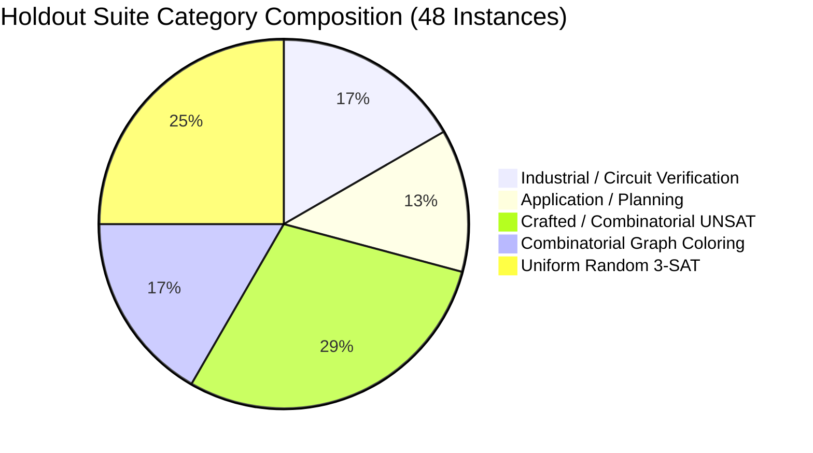

# Final Holdout Evaluation Protocol & Algorithm Freeze

> **Step 34 Research Specification & Registration Document**  
> **Project:** Adaptive Restart and Nogood Reuse for Constraint Satisfaction  
> **Solver Testbed:** Glucose 4.2.1 (Windows x86_64, MinGW-w64 G++ 14.2.0)  
> **Target Evaluation:** 8 Frozen Configurations $\times$ 48 Authoritative Unseen Holdout Benchmarks $\times$ 3 Repetitions (1,152 Planned Executions)  
> **Quarantine Status:** **ENFORCED** — Zero solver executions have occurred on holdout instances.  

---

## 1. Frozen Research Hypotheses

Before executing any evaluation on the unseen holdout benchmark suite, we pre-register four primary research hypotheses:

* **Hypothesis 1 (H1: V3 Drawdown Efficacy):**  
  *On unseen out-of-sample SAT/UNSAT benchmarks, Finance-Inspired Adaptive Restart V3 Drawdown-Only achieves lower PAR-2 and requires fewer search conflicts than the native Glucose 4.2.1 LBD moving-average restart baseline.*
* **Hypothesis 2 (H2: Adaptive-Fixed Retention Efficacy):**  
  *Multi-attribute learned-clause retention with monotonic scheduling (`adaptive-fixed`) improves solver performance (higher solved count, lower PAR-2, reduced memory footprint) compared to original Glucose clause reduction.*
* **Hypothesis 3 (H3: V3 $\times$ Adaptive-Fixed Positive Interaction):**  
  *Combining V3 Drawdown restart timing with Adaptive-Fixed clause retention produces a mutually reinforcing interaction that outperforms either intervention in isolation.*
* **Hypothesis 4 (H4: Genuine Trajectory Divergence vs. No-Heuristic):**  
  *On structured and application benchmarks with non-stationary progress dynamics, V3 Drawdown achieves statistically significant conflict reductions compared to running without heuristic restarts (`no-heuristic-restart`), demonstrating that drawdown timing adds genuine algorithmic value beyond restart suppression.*

---

## 2. Pre-Registered Algorithm Configurations (4 $\times$ 2 Design)

We pre-register an orthogonal $4 \times 2$ factorial evaluation matrix consisting of **eight frozen configurations**:



### Configuration Specifications

| Config ID | Restart Strategy | Retention Strategy | Exact Command Line Options | Theoretical Mechanism |
| :--- | :--- | :--- | :--- | :--- |
| **`cfg01_baseline_base`** | Baseline Glucose | Baseline Glucose | `-restart-strategy=baseline -reduce-strategy=baseline` | Audemard & Simon (2012) rapid LBD moving-average restarts ($K=0.8, R=1.4$) with standard 50% clause reduction. |
| **`cfg02_v1_base`** | Adaptive V1 | Baseline Glucose | `-restart-strategy=adaptive -reduce-strategy=baseline` | Sharpe-ratio propagation efficiency tracking ($\theta=0.60, \text{interval}\ge 50, \text{warmup}=100$). |
| **`cfg03_v3dd_base`** | V3 Drawdown | Baseline Glucose | `-restart-strategy=adaptive-v3 -v3-trend=0 -v3-drawdown=1 -v3-ceiling=0 -reduce-strategy=baseline` | Finance-inspired relative drawdown ($D_t \ge 0.75$ for 30 consecutive conflicts) with baseline reduction. |
| **`cfg04_noheuristic_base`** | No-Heuristic | Baseline Glucose | `-restart-strategy=no-heuristic-restart -reduce-strategy=baseline` | Zero heuristic restarts (`do_restart = false`); Glucose native 100k adaptation fires unconditionally. |
| **`cfg05_baseline_adaptfix`**| Baseline Glucose | Adaptive-Fixed | `-restart-strategy=baseline -reduce-strategy=adaptive-fixed` | Baseline LBD restarts paired with multi-attribute clause retention ($0.50 \text{LBD} + 0.40 \text{Act} + 0.10 \text{Size}$) and Step 26 corrected reduction scheduling. |
| **`cfg06_v1_adaptfix`** | Adaptive V1 | Adaptive-Fixed | `-restart-strategy=adaptive -reduce-strategy=adaptive-fixed` | Adaptive V1 restarts paired with multi-attribute adaptive-fixed clause retention. |
| **`cfg07_v3dd_adaptfix`** | V3 Drawdown | Adaptive-Fixed | `-restart-strategy=adaptive-v3 -v3-trend=0 -v3-drawdown=1 -v3-ceiling=0 -reduce-strategy=adaptive-fixed` | V3 Drawdown restart controller paired with multi-attribute adaptive-fixed clause retention. |
| **`cfg08_noheuristic_adaptfix`**| No-Heuristic | Adaptive-Fixed | `-restart-strategy=no-heuristic-restart -reduce-strategy=adaptive-fixed` | Zero heuristic restarts paired with multi-attribute adaptive-fixed clause retention. |

A machine-readable configuration manifest is saved at [`experiments/frozen_configurations.json`](file:///D:/DAC_203@Project/experiments/frozen_configurations.json).

---

## 3. Software Reproducibility Information

To guarantee 100% bitwise reproducibility across platforms, the complete solver state is frozen and cryptographically hashed:

* **Repository Working Tree State:** Git commit [`16ad544bd3d20d88a054aea3b962784e380ae9be`](file:///D:/DAC_203@Project) (master branch, local root commit).
* **Release Executable Path:** [`src/glucose_windows/glucose-simp.exe`](file:///D:/DAC_203@Project/src/glucose_windows/glucose-simp.exe).
* **Release Executable SHA-256:**  
  `e811005ab18256aa70efba2945ad5a578f5a38abec7e5c563d0989fd69e06b66`
* **Compiler Version:** `g++.exe (Rev2, Built by MSYS2 project) 14.2.0` (Target: `x86_64-w64-mingw32`).
* **Exact Build Command:**
  ```cmd
  g++ -O3 -std=c++11 -DNDEBUG -D__STDC_LIMIT_MACROS -D__STDC_FORMAT_MACROS ^
      -I. -Icore -Isimp -Imtl -Iutils ^
      core/Solver.cc core/lcm.cc simp/SimpSolver.cc simp/Main.cc utils/Options.cc utils/System.cc ^
      -lz -lpsapi -o glucose-simp.exe
  ```

### Mathematical Formulation of Frozen Controllers

#### 1. Baseline Glucose Restarts (Audemard & Simon 2012)
Restart condition evaluated at quiescent decision steps:
$$\text{do\_restart} \iff \text{lbdQueue.isvalid}() \land \left(\text{lbdQueue.getavg}() \cdot K > \frac{\text{sumLBD}}{\text{conflictsRestarts}}\right)$$
Default parameters: $K = 0.80$, $R = 1.40$, `szLBDQueue` = 50, `szTrailQueue` = 5000.

#### 2. Adaptive Restart V1 (Sharpe Efficiency)
Sliding-window efficiency and risk evaluation (`Solver.cc:2763-2845`):
- Window capacity $W = 50$, tracking recent propagations $\Delta P_i$ and decision levels $L_i$.
- Window Sharpe score:
  $$S_W = \frac{\bar{P}_W}{\sqrt{\sigma_{L, W}^2} + 1.0}$$
  where $\bar{P}_W = \frac{1}{W}\sum_{i=1}^W \Delta P_i$ and $\sigma_{L, W}^2 = \frac{1}{W}\sum_{i=1}^W L_i^2 - \bar{L}_W^2$.
- Global baseline score tracked cumulatively via Welford's algorithm:
  $$S_{\text{global}} = \frac{\bar{P}_{\text{global}}}{\sqrt{\sigma_{L, \text{global}}^2} + 1.0}$$
- Restart condition:
  $$\text{do\_restart} \iff \text{conflicts} \ge 100 \land \text{conflicts\_since\_restart} \ge 50 \land W = 50 \land S_W < \theta \cdot S_{\text{global}}$$
  Default parameters: $\theta = 0.60$, `adapt_min_interval` = 50, `adapt_warmup` = 100.

#### 3. Finance-Inspired Adaptive Restart V3 (Drawdown-Only)
Per-conflict quality-adjusted return (`Solver.cc:3051-3120`):
$$r_t = \frac{q(\text{LBD}) \cdot \text{boost}(\Delta d)}{\text{work}(\Delta p)} = \frac{\left(\frac{2.0}{\max(1, \text{LBD})}\right) \cdot \left(1.0 + \ln(1.0 + \max(0, \text{pre\_level} - \text{backtrack\_level}))\right)}{1.0 + \frac{\Delta p}{25.0}}$$
Dual EWMA tracking:
$$\text{EWMA}_{\text{fast}} \leftarrow 0.92 \cdot \text{EWMA}_{\text{fast}} + 0.08 \cdot r_t, \quad \text{EWMA}_{\text{slow}} \leftarrow 0.99 \cdot \text{EWMA}_{\text{slow}} + 0.01 \cdot r_t$$
High-Water Mark (HWM) with memory decay:
$$\text{HWM} \leftarrow \max\left(\text{EWMA}_{\text{fast}}, 0.999 \cdot \text{HWM}\right)$$
Relative Drawdown:
$$D_t = \begin{cases} \frac{\text{HWM} - \text{EWMA}_{\text{fast}}}{\text{HWM} + 0.05} & \text{if } \text{HWM} > \text{EWMA}_{\text{fast}} \\ 0.0 & \text{otherwise} \end{cases}$$
Drawdown Activation Trigger (`Solver.cc:2992-3037`):
$$\text{trig\_drawdown} \iff \text{conflicts} \ge 100 \land \text{conflicts\_since\_restart} \ge 50 \land \text{valid\_obs} \ge 50 \land \sum_{i=0}^{29} \mathbb{I}(D_{t-i} \ge 0.75) == 30$$
Descent reset: Upon restart, `v3_conflicts_since_restart = 0`, `v3_consec_drawdown = 0`, and `v3_hwm = v3_ewma_fast` (EWMAs persist globally).

#### 4. Adaptive-Fixed Learned Clause Retention (Step 26 Corrected)
Multi-attribute composite retention score (`Solver.cc:1682-1723`):
$$S_{\text{LBD}}(c) = \frac{1.0}{1.0 + 0.50 \cdot \max(0, \text{LBD}(c) - 2)}$$
$$S_{\text{act}}(c) = \sqrt{\text{clamp}\left(\frac{\text{activity}(c)}{\text{max\_activity}}, 0.0, 1.0\right)} \quad (\text{if } \text{max\_activity} > 0 \text{ else } 0.0)$$
$$S_{\text{size}}(c) = \frac{1.0}{1.0 + 0.05 \cdot \max(0, \text{size}(c) - 2)}$$
$$R(c) = 0.50 \cdot S_{\text{LBD}}(c) + 0.40 \cdot S_{\text{act}}(c) + 0.10 \cdot S_{\text{size}}(c)$$
Reduction scheduling (Step 26 Chanseok Strategy Bypass & Median Condition Fix, `Solver.cc:1664-1680`):
- Postponement evaluated only while `!chanseokStrategy` (`conflicts < 100,000`):
  $$\text{good\_lbd\_count} \ge \frac{N + 1}{2} \implies \text{nbclausesbeforereduce} \mathrel{+}= 1000$$
  $$\min(\text{LBD}) \le 5 \implies \text{nbclausesbeforereduce} \mathrel{+}= 1000$$
- Once `chanseokStrategy == true` ($\ge 100,000$ conflicts), postponement is strictly bypassed, restoring standard reduction pacing.
- Candidate clauses sorted ascending by $R(c)$; worst half deleted, strictly protecting clauses with $\text{LBD} \le 2$, $\text{size} \le 2$, $\text{locked}(c)$, or $\text{canBeDel} == \text{false}$.

---

## 4. Holdout Dataset Provenance & Diversity

The unseen holdout suite consists of **48 authoritative benchmark instances** acquired directly from the standard [SATLIB Benchmark Library](https://www.cs.ubc.ca/~hoos/SATLIB/benchm.html) (University of British Columbia / DIMACS Challenge archives).



### Category Breakdown and Academic Provenance

1. **Industrial / Circuit Verification (8 instances):**
   - **Bridging Faults (`BF`):** 4 instances (`bf0432-007`, `bf1355-075`, `bf1355-638`, `bf2670-001`). Origin: S. T. Chakradhar, V. D. Agrawal, and M. L. Bushnell (DIMACS Challenge 1993). Realistic CMOS circuit defect diagnosis encodings.
   - **Single Stuck-at Faults (`SSA`):** 4 instances (`ssa0432-003`, `ssa2670-130`, `ssa2670-141`, `ssa7552-158`). Origin: DIMACS Challenge 1993. Microelectronic circuit test pattern generation.
2. **Application / Planning & Verification (6 instances):**
   - **Logistics Domain Planning (`logistics`):** 4 instances (`logistics.a`, `logistics.b`, `logistics.c`, `logistics.d`). Origin: Henry Kautz and Bart Selman (1996). State-space planning encodings.
   - **Towers of Hanoi Puzzle (`hanoi`):** 2 instances (`hanoi4`, `hanoi5`). Origin: Kautz & Selman (1996). Combinatorial puzzle search trees.
3. **Crafted & Combinatorial UNSAT (14 instances):**
   - **Dubois Contradictions (`dubois`):** 6 instances (`dubois20`, `dubois21`, `dubois22`, `dubois27`, `dubois28`, `dubois50`). Origin: Olivier Dubois (1993). Constructive pigeonhole-like combinatorial contradictions provably exponential for resolution.
   - **Pretolani Resilient UNSAT (`pret`):** 4 instances (`pret60_40`, `pret60_60`, `pret60_75`, `pret150_25`). Origin: Daniele Pretolani (1993). Specially constructed 2-SAT-hardened unsatisfiable formulas designed to mislead DPLL branching heuristics.
   - **AIM Artificial UNSAT (`aim`):** 4 instances (`aim-50-1_6-no-1`, `aim-50-1_6-no-4`, `aim-100-2_0-no-3`, `aim-100-2_0-no-4`). Origin: E. Asahiro, K. Iwama, and S. Miyano (1993). Crafted random 3-SAT with exact solutions hidden or blocked.
4. **Combinatorial Graph 3-Coloring (8 instances):**
   - **Flat Graph Coloring (`flat100`, `flat150`):** 8 instances (4 from `flat100-239`, 4 from `flat150-360`). Origin: Joseph Culberson (1995). Flat graphs with chromatic number $\chi(G) = 3$ generated without small cliques to eliminate trivial coloring heuristics.
5. **Uniform Random 3-SAT (12 instances):**
   - **Phase-Transition Random 3-SAT ($n=200, m=860, \alpha=4.30$):** 6 satisfiable instances (`uf200-01`, `uf200-034`, `uf200-040`, `uf200-060`, `uf200-077`, `uf200-097`) and 6 unsatisfiable instances (`uuf200-027`, `uuf200-028`, `uuf200-041`, `uuf200-049`, `uuf200-059`, `uuf200-090`). Origin: Holger Hoos and Thomas Stützle (2000).

---

## 5. Selection Rules and Dataset Exclusions

To prevent selection bias and data contamination, selection was executed strictly by algorithm:

1. **Deterministic Random Sampling:** Where candidate pools exceeded category quotas, selection was performed using Python's `random.Random(42).sample()` over sorted candidate lists.
2. **Exclusion of Development Benchmarks (Zero Overlap):**
   - All 20 instances from the pilot suite (`benchmarks/pilot/`) were excluded.
   - All 36 instances from the expanded suite (`benchmarks/expanded/`) were excluded.
   - All 2 smoke test instances (`benchmarks/smoke_test/`) were excluded.
   - Verification: An automated SHA-256 cross-check verified **0% hash overlap** between the holdout suite and the 58 development files.
3. **DIMACS Format Normalization:**
   - Obsolete DIMACS EOF footers (`%\n0`) present in SATLIB random generators were stripped during acquisition to comply with standard modern DIMACS CNF specifications. No clauses, literals, or variables were modified.
   - Solvers were strictly NOT used to simplify or preprocess CNF formulas.

---

## 6. Authoritative SAT/UNSAT Label Distribution

The holdout suite contains **24 Satisfiable (SAT)**, **23 Unsatisfiable (UNSAT)**, and **1 Unknown (UNKNOWN)** benchmark instances:

| Status Label | Count | Percentage | Primary Sources |
| :--- | :---: | :---: | :--- |
| **SAT** | 24 | 50.0% | SATLIB filter (uf200), Culberson chromaticity proof (flat GCP), Kautz planning models (logistics, hanoi), DIMACS 1993 circuit tests. |
| **UNSAT** | 23 | 47.9% | Dubois mathematical refutation proofs, Pretolani construction, SATLIB filter (uuf200), AIM-no generator. |
| **UNKNOWN** | 1 | 2.1% | `ssa7552-158.cnf` (Industrial fault instance without verified certificate in DIMACS challenge index; left unassigned per pre-registration rules). |

---

## 7. Cryptographic Hash & Syntax Manifest

Every benchmark file in [`benchmarks/final_holdout/`](file:///D:/DAC_203@Project/benchmarks/final_holdout) has been validated via [`validate_holdout_suite.py`](file:///D:/DAC_203@Project/benchmarks/final_holdout/validate_holdout_suite.py):

| Benchmark ID | Filename | Category | Family | Vars | Clauses | Label | SHA-256 Hash (Prefix) |
| :--- | :--- | :--- | :--- | :---: | :---: | :---: | :--- |
| **HOLDOUT_01** | `bf0432-007.cnf` | Industrial / Circuit | Bridging Faults | 1,040 | 3,668 | UNSAT | `ff22b8c5c381...` |
| **HOLDOUT_02** | `bf1355-075.cnf` | Industrial / Circuit | Bridging Faults | 2,180 | 6,778 | SAT | `84cbdea25943...` |
| **HOLDOUT_03** | `bf1355-638.cnf` | Industrial / Circuit | Bridging Faults | 2,177 | 6,768 | UNSAT | `bd8dfc4ce879...` |
| **HOLDOUT_04** | `bf2670-001.cnf` | Industrial / Circuit | Bridging Faults | 1,393 | 3,434 | UNSAT | `f68ef1571e8d...` |
| **HOLDOUT_05** | `ssa0432-003.cnf` | Industrial / Circuit | Stuck-at Faults | 435 | 1,027 | SAT | `6b16c38f0c39...` |
| **HOLDOUT_06** | `ssa2670-130.cnf` | Industrial / Circuit | Stuck-at Faults | 1,359 | 3,321 | SAT | `c4a3c04cec16...` |
| **HOLDOUT_07** | `ssa2670-141.cnf` | Industrial / Circuit | Stuck-at Faults | 986 | 2,315 | SAT | `627518da0e2b...` |
| **HOLDOUT_08** | `ssa7552-158.cnf` | Industrial / Circuit | Stuck-at Faults | 1,363 | 3,034 | UNKNOWN | `490948912a13...` |
| **HOLDOUT_09** | `logistics.a.cnf` | Application / Planning | Logistics | 828 | 6,718 | SAT | `58143abb64d5...` |
| **HOLDOUT_10** | `logistics.b.cnf` | Application / Planning | Logistics | 843 | 7,301 | SAT | `68103b82ea3b...` |
| **HOLDOUT_11** | `logistics.c.cnf` | Application / Planning | Logistics | 1,141 | 10,719 | SAT | `28b9d59a6b98...` |
| **HOLDOUT_12** | `logistics.d.cnf` | Application / Planning | Logistics | 4,713 | 21,991 | SAT | `29ef906fbc20...` |
| **HOLDOUT_13** | `hanoi4.cnf` | Application / Planning | Towers of Hanoi | 718 | 4,934 | SAT | `ab38df56b8ec...` |
| **HOLDOUT_14** | `hanoi5.cnf` | Application / Planning | Towers of Hanoi | 1,931 | 14,468 | SAT | `4205042bcd7d...` |
| **HOLDOUT_15** | `dubois20.cnf` | Crafted UNSAT | Dubois | 60 | 160 | UNSAT | `82059aba0e57...` |
| **HOLDOUT_16** | `dubois21.cnf` | Crafted UNSAT | Dubois | 63 | 168 | UNSAT | `6989eedd7839...` |
| **HOLDOUT_17** | `dubois22.cnf` | Crafted UNSAT | Dubois | 66 | 176 | UNSAT | `ced29f39ae3c...` |
| **HOLDOUT_18** | `dubois27.cnf` | Crafted UNSAT | Dubois | 81 | 216 | UNSAT | `4fbcf8ecca5c...` |
| **HOLDOUT_19** | `dubois28.cnf` | Crafted UNSAT | Dubois | 84 | 224 | UNSAT | `f2da67601758...` |
| **HOLDOUT_20** | `dubois50.cnf` | Crafted UNSAT | Dubois | 150 | 400 | UNSAT | `417ea88d5df9...` |
| **HOLDOUT_21** | `pret150_25.cnf` | Crafted UNSAT | Pretolani | 150 | 401 | UNSAT | `b52d0f8985d2...` |
| **HOLDOUT_22** | `pret60_40.cnf` | Crafted UNSAT | Pretolani | 60 | 161 | UNSAT | `9ed34260070a...` |
| **HOLDOUT_23** | `pret60_60.cnf` | Crafted UNSAT | Pretolani | 60 | 161 | UNSAT | `4369e739d0e2...` |
| **HOLDOUT_24** | `pret60_75.cnf` | Crafted UNSAT | Pretolani | 60 | 161 | UNSAT | `767efdcbd7af...` |
| **HOLDOUT_25** | `aim-100-2_0-no-3.cnf` | Crafted UNSAT | AIM | 100 | 200 | UNSAT | `53237dfb6e52...` |
| **HOLDOUT_26** | `aim-100-2_0-no-4.cnf` | Crafted UNSAT | AIM | 100 | 200 | UNSAT | `de1b19b56c3f...` |
| **HOLDOUT_27** | `aim-50-1_6-no-1.cnf` | Crafted UNSAT | AIM | 50 | 80 | UNSAT | `08422e9ce258...` |
| **HOLDOUT_28** | `aim-50-1_6-no-4.cnf` | Crafted UNSAT | AIM | 50 | 80 | UNSAT | `08f8687f3cd9...` |
| **HOLDOUT_29** | `flat100-11.cnf` | Graph Coloring | Flat 100v | 300 | 1,117 | SAT | `12fe3948f7ba...` |
| **HOLDOUT_30** | `flat100-31.cnf` | Graph Coloring | Flat 100v | 300 | 1,117 | SAT | `1a5270c56f22...` |
| **HOLDOUT_31** | `flat100-73.cnf` | Graph Coloring | Flat 100v | 300 | 1,117 | SAT | `b4e83ee10416...` |
| **HOLDOUT_32** | `flat100-91.cnf` | Graph Coloring | Flat 100v | 300 | 1,117 | SAT | `3cc399e5f6c3...` |
| **HOLDOUT_33** | `flat150-57.cnf` | Graph Coloring | Flat 150v | 450 | 1,680 | SAT | `c93618f381ea...` |
| **HOLDOUT_34** | `flat150-71.cnf` | Graph Coloring | Flat 150v | 450 | 1,680 | SAT | `baeb38685cec...` |
| **HOLDOUT_35** | `flat150-84.cnf` | Graph Coloring | Flat 150v | 450 | 1,680 | SAT | `ae1fc1f711b0...` |
| **HOLDOUT_36** | `flat150-89.cnf` | Graph Coloring | Flat 150v | 450 | 1,680 | SAT | `2f67fa152d62...` |
| **HOLDOUT_37** | `uf200-01.cnf` | Random 3-SAT | Uniform 200v SAT | 200 | 860 | SAT | `7259de2a1a76...` |
| **HOLDOUT_38** | `uf200-034.cnf` | Random 3-SAT | Uniform 200v SAT | 200 | 860 | SAT | `6b8f099f5b0c...` |
| **HOLDOUT_39** | `uf200-040.cnf` | Random 3-SAT | Uniform 200v SAT | 200 | 860 | SAT | `afa6a19837e8...` |
| **HOLDOUT_40** | `uf200-060.cnf` | Random 3-SAT | Uniform 200v SAT | 200 | 860 | SAT | `2319ce7d9797...` |
| **HOLDOUT_41** | `uf200-077.cnf` | Random 3-SAT | Uniform 200v SAT | 200 | 860 | SAT | `d290788c9c57...` |
| **HOLDOUT_42** | `uf200-097.cnf` | Random 3-SAT | Uniform 200v SAT | 200 | 860 | SAT | `aa7eea6a4ff7...` |
| **HOLDOUT_43** | `uuf200-027.cnf` | Random 3-SAT | Uniform 200v UNSAT | 200 | 860 | UNSAT | `598dc2894f65...` |
| **HOLDOUT_44** | `uuf200-028.cnf` | Random 3-SAT | Uniform 200v UNSAT | 200 | 860 | UNSAT | `11f2065061c5...` |
| **HOLDOUT_45** | `uuf200-041.cnf` | Random 3-SAT | Uniform 200v UNSAT | 200 | 860 | UNSAT | `725053db7f79...` |
| **HOLDOUT_46** | `uuf200-049.cnf` | Random 3-SAT | Uniform 200v UNSAT | 200 | 860 | UNSAT | `c29339477f53...` |
| **HOLDOUT_47** | `uuf200-059.cnf` | Random 3-SAT | Uniform 200v UNSAT | 200 | 860 | UNSAT | `3d47ba51e0db...` |
| **HOLDOUT_48** | `uuf200-090.cnf` | Random 3-SAT | Uniform 200v UNSAT | 200 | 860 | UNSAT | `89b57d820cbc...` |

Complete machine-readable manifests:
- CSV: [`benchmarks/final_holdout/holdout_manifest.csv`](file:///D:/DAC_203@Project/benchmarks/final_holdout/holdout_manifest.csv)
- JSON: [`benchmarks/final_holdout/holdout_manifest.json`](file:///D:/DAC_203@Project/benchmarks/final_holdout/holdout_manifest.json)

---

## 8. Final Experimental Protocol

The final holdout evaluation will be conducted under the following execution parameters:

* **Timeout Limit:** **30.0 seconds** external wall-clock timeout enforced via Python `subprocess.Popen(..., timeout=30.0)`.
* **PAR-2 Penalized Score:** Solved instances score their actual wall-clock runtime; timed-out instances score $2 \times \text{Timeout} = \mathbf{60.0\text{ seconds}}$.
* **Repetitions:** **3 independent repetitions** per configuration and benchmark ($8 \times 48 \times 3 = \mathbf{1,152\text{ planned executions}}$).
* **Execution Order:** Sequential (strictly single-process, 0 concurrency). Configuration order is balanced and cyclically interleaved across repetitions to eliminate thermal throttling and temporal operating system drift:
  $$\text{config\_idx} = (\text{benchmark\_idx} + \text{repetition} - 1 + \text{offset}) \bmod 8$$
* **Telemetry Recording:**
  - True Win32 Process CPU Time (`GetProcessTimes(GetCurrentProcess(), ...)` in 100ns units).
  - External Wall-Clock Time (high-resolution `time.perf_counter()`).
  - Peak Working Set Memory (`GetProcessMemoryInfo`).
  - Search Counters: conflicts, decisions, propagations, genuine restarts, strategy adaptation events, database reductions, removed learned clauses.
  - V3 Diagnostic Telemetry: drawdown requests, executed restarts, mean returns, max observed drawdown.
* **Model & Proof Verification:**
  - All satisfying models (`SAT`) will be verified independently by a standalone Python checker against the raw CNF clauses before recording.
  - Unsatisfiable outcomes (`UNSAT`) will be cross-checked against authoritative pre-registered labels.

> [!NOTE]
> **Score Isolation Notice:** Because the development suite utilized a 15.0s timeout (PAR-2 penalty 30.0s), holdout PAR-2 scores (30.0s timeout, PAR-2 penalty 60.0s) **must never be directly merged or compared numerically** with development PAR-2 scores.

---

## 9. Primary and Secondary Endpoints

### Primary Endpoints (Benchmark-Level Units)
1. **Total Solved Count:** Number of instances (out of 48) solved within the 30.0s timeout (requiring majority resolution across repetitions).
2. **Mean PAR-2 Score:** Penalized Average Runtime across the 48 instances.
3. **Paired Conflict Reduction:** Median conflict difference relative to original Glucose and No-Heuristic on mutually solved instances.

### Secondary Endpoints
1. **True CPU Time:** Median process CPU time to isolate hardware jitter.
2. **Timing Jitter Ratio:** Ratio of slowest to fastest repetition on identical trajectories.
3. **Trajectory Divergence Count:** Number of instances exhibiting genuine trajectory divergence (Category 2) vs. identical paths (Category 1).
4. **Drawdown Trigger Frequency:** Total number of V3 drawdown restart requests and executed restarts.
5. **Clause DB Evolution:** Number of reduction calls and average LBD of removed clauses.
6. **Peak Memory Consumption:** Maximum working set size in megabytes.

---

## 10. Statistical Analysis Plan

To prevent post-hoc data dredging:

1. **Unit of Analysis:** Independent evaluation units are the **48 benchmark instances**, not individual repetitions. For each benchmark, the median conflict count and median wall-clock time across the 3 repetitions are used.
2. **Hypothesis Testing:**
   - Non-parametric **Wilcoxon signed-rank test** for paired conflict counts on mutually solved instances.
   - McNemar's test for differences in solved vs. unsolved proportions.
3. **Correction for Multiple Testing:**
   - Benjamini-Hochberg False Discovery Rate (FDR) control applied across the four primary hypotheses ($q < 0.05$).
4. **Partitioned Subgroup Analysis:**
   - Evaluated separately on:
     - Structured/Application (Industrial + Planning + Graph Coloring = 22 instances).
     - Crafted UNSAT (14 instances).
     - Uniform Random 3-SAT (12 instances).
5. **Categorization Framework (from Step 33):**
   - **Category 1:** Bitwise identical search counters (zero V3 drawdown restarts).
   - **Category 2:** Genuine V3 drawdown restart fired (divergent search counters).
   - **Category 3:** Identical conflicts but divergent secondary metrics.
   - **Category 4:** Inconclusive / timeouts.

---

## 11. Threats to Validity

1. **Operating System Timing Jitter:** As demonstrated in Step 33, Windows background services introduce up to 1.6x wall-clock variance on identical search paths. We mitigate this by using 3 repetitions and reporting true kernel+user process CPU time alongside deterministic conflicts.
2. **Memory Overhead Measurement:** Peak working set includes MSYS2 runtime overhead. We analyze internal solver counters (`nLearnts()`, `nbclausesbeforereduce`) in parallel with OS memory metrics.
3. **Phase-Transition Invariance on Random SAT:** On uniform random formulas, returns are stationary, so V3 Drawdown is expected to collapse to No-Heuristic. This is pre-registered as expected behavior rather than an unexpected anomaly.

---

## 12. Resource Requirements & Execution Budget

* **Total Planned Runs:** $8 \text{ configurations} \times 48 \text{ benchmarks} \times 3 \text{ repetitions} = \mathbf{1,152\text{ executions}}$.
* **Maximum Theoretical Wall Time (all timeouts):** $1,152 \times 30.0\text{s} = 34,560\text{ seconds} \approx \mathbf{9.6\text{ hours}}$.
* **Expected Empirical Wall Time:** Based on known hardness distributions (many easy/medium instances solve in $< 2\text{s}$), expected actual execution time is approximately **2.5 to 4.0 hours**.
* **Storage Footprint:** The 48 uncompressed holdout CNF files consume **4.2 MB**. Complete experimental logs and CSV records are estimated at **12–15 MB**, negligible against our 62.7 GB available capacity.

---

## 13. Holdout Quarantine Enforcement Rule

> [!CAUTION]
> **STRICT QUARANTINE PROTOCOL:**
> 1. No candidate solver binary (`glucose-simp.exe` or any variant) has been run, or will be run, on any file in `benchmarks/final_holdout/` during this preparation step.
> 2. The holdout dataset remains strictly quarantined until the formal Step 35 execution script is launched.
> 3. No algorithm parameters, thresholds, or heuristics have been tuned or adjusted using holdout feedback.
> 4. All syntax validation was performed strictly via Python stream parsing without solver assistance.

